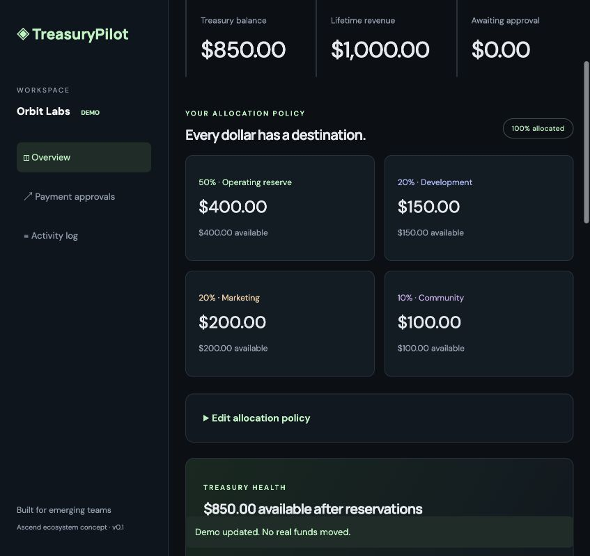
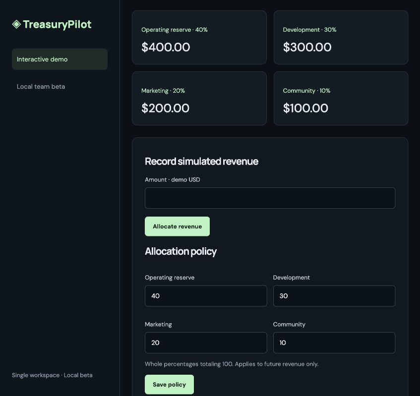

# TreasuryPilot

**Turn project revenue into accountable team budgets.**

[Try the public interactive demo](https://treasurypilot-gamma.vercel.app) · [Source code](https://github.com/kivancbeser/treasurypilot)

The public demo uses simulated browser-local data and requires no account. The authenticated team beta runs locally and is not deployed to Vercel.

TreasuryPilot is an early-stage treasury operations prototype for teams launching in emerging ecosystems, including Ascend / Elysium. It demonstrates revenue allocation, budget reservations, two-person payment review, and a readable activity history.

**Status: interactive demo plus an authenticated local team beta. No blockchain integration, wallet authentication, custody, or real transfers. Not affiliated with or endorsed by Ascend, Elysium, or Kinetiq.**

## Run locally

Requires Node.js 20 or newer. No packages or API keys needed.

```sh
npm start
```

Open http://127.0.0.1:4173. Run accounting and approval checks with `npm test`.



## Local team beta

```sh
npm run setup:local
npm start
```

Open http://127.0.0.1:4173/beta. The setup command generates unique passwords and stores them in `data/local-access.txt` (excluded from Git; local file permissions 0600). It creates `kivanc` as admin and two fictional test accounts, `builder-demo` and `reviewer-demo`. Setup refuses to replace existing accounts. Do not publish the access file or use real financial information.

- **Admin:** record simulated revenue, change policy, request payments, review another user's requests.
- **Requester:** request and cancel their own pending payments.
- **Reviewer:** approve or reject another user's pending payments.
- Every account can read this single shared workspace and export payments. There is no organization isolation in this beta.

Use separate browser sessions or sign out and back in to test different accounts. The server derives the actor from the session; client-supplied requester names cannot impersonate another account. Self-approval is rejected even for admins.

To provision another local account, run `node scripts/add-user.mjs username requester` (or `admin` / `reviewer`) and provide a 12–128 character password on standard input, then EOF. Use a terminal that does not echo input or a password manager pipeline. Do not put passwords in command arguments.

Data persists in `data/treasury.json`. `TREASURY_DATA` can select a different path. Run only one process per data file and stop it before running provisioning commands. Keep local backups. This beta has no account recovery, MFA, invitations, public signup, or production deployment configuration. Sessions expire after eight hours and are invalidated on restart. Login throttling is in memory.

**Local use only:** the server binds to loopback HTTP. Do not expose or reverse-proxy it to the internet. Production deployment requires HTTPS and Secure cookies, a durable database and distributed coordination, hardened authentication, and independent security review.



## Two-minute walkthrough

1. Allocate 1,000 demo USD. Reserve receives 400, development 300, marketing 200, and community 100.
2. Request 150 from Development to `0x1111111111111111111111111111111111111111` for “Frontend milestone 1”.
3. Observe the pending reservation: Development has 300 total and 150 available.
4. Switch the simulated team member to Alex and approve. Development now has 150. No funds are sent.
5. Request another payment and reject it to release its reservation. Inspect the activity log.

Use **Load sample workspace** for a fictional scenario with approved and pending payments. Switch between Kivanc and Alex to explore requesting, cancellation, and separate review.

Demo state is stored in localStorage. Reset demo clears it after confirmation. Do not enter sensitive information.

## What is implemented

- Editable allocation policy (40/30/20/10 by default) for future revenue, with integer-cent accounting and largest-remainder allocation.
- Budget checks that account for pending reservations.
- Payment requests, explicit simulated role switching, requester cancellation, approval, and rejection.
- Treasury health summary showing available funds after pending reservations.
- Runway scenario planner using user-entered spending and revenue assumptions; not a forecast.
- Design-partner pilot invitation linking to the founder’s X profile.
- Payment status filters and CSV export with spreadsheet formula-prefix protection.
- Guided example workspace, responsive dashboard, and browser-local activity history.
- Saved-state validation with accounting and reservation consistency checks.
- Dependency-free Node test suite and an optional CI workflow example (`ci-workflow.example.yml`).

## Limits and trust model

On `/`, roles are simulated in one browser, not authenticated. On `/beta`, provisioned accounts authenticate with passwords and the server enforces roles; all monetary actions remain simulations. Browser storage can be edited and is not an immutable audit trail. Wallet address validation checks format only. Accounting uses two decimal places for simulated USD; production token accounting requires token-specific integer precision. Deposits are manual simulations and do not verify revenue origin. Approval updates local accounting only. The UI uses Google Fonts with system-font fallbacks.

## Technical review

See [architecture and trust boundaries](docs/ARCHITECTURE.md). Twelve automated tests (including an HTTP integration scenario) cover the core accounting, policy, lifecycle, storage validation, and export behavior. These are not an independent security audit.

## Planned next steps

1. Validate the workflow with three project teams and refine approval policies.
2. Harden the local team beta with a production database, account lifecycle management, and deployment security.
3. Build and test a minimal on-chain vault with verified token configuration, real multisignature authorization, and constrained payouts.
4. Deploy to a supported testnet; publish verified contract addresses and transaction evidence.
5. Complete independent security review before any real-fund release.

No Ascend API, revenue integration, token deployment, or partner relationship is claimed. Any future Ascend revenue receipt would be treated as an input to the team's treasury, under separately agreed integration terms.

## Contact

Kivanc — Founder · [X: @coinstampp](https://x.com/coinstampp) · Discord: `kivanc.coinstamp`

## License

MIT. See LICENSE.

## Static demo deployment

`npm run build:demo` creates an allowlisted `dist/` containing only the demo HTML, CSS and two browser modules. `vercel.json` deploys this directory; `.vercelignore` excludes local records, credentials, account provisioning, and the beta backend. The public build replaces the local beta navigation with a source-code link. No account files or server endpoints are published.
